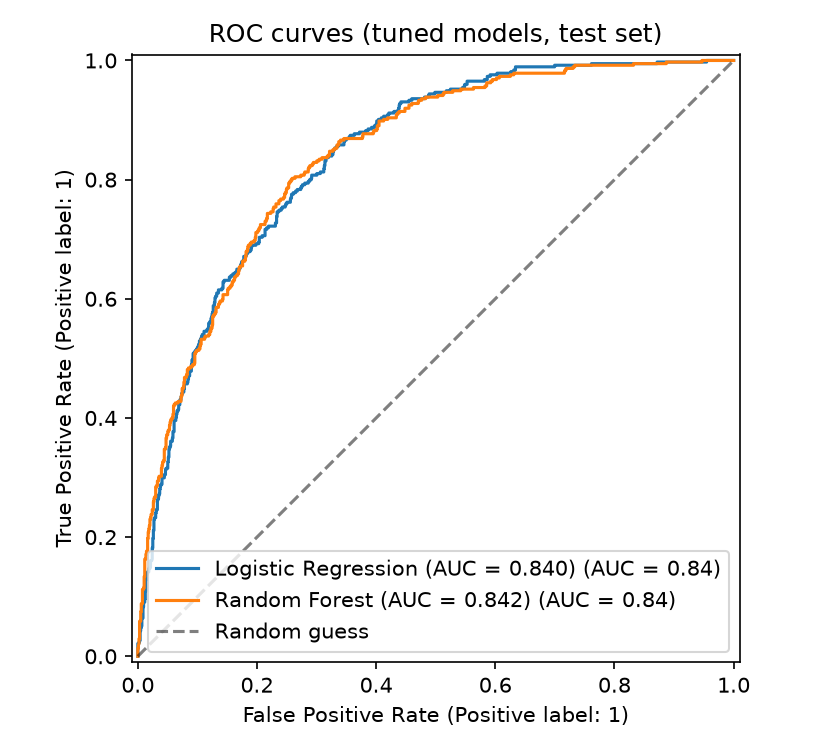
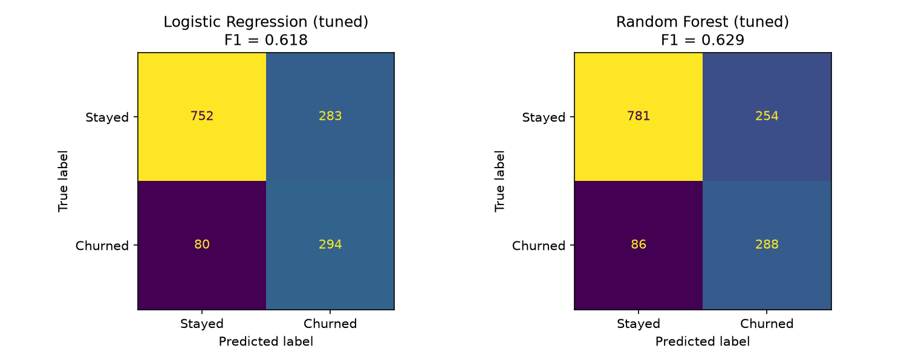
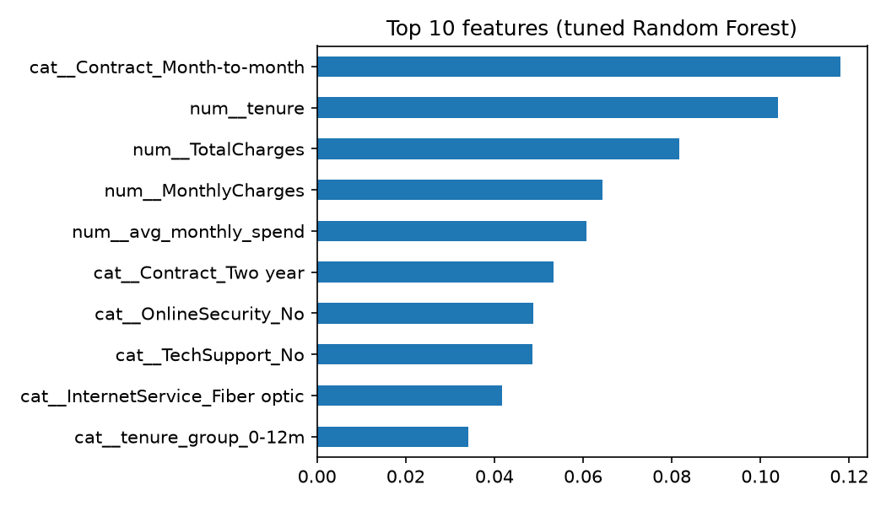

# Customer Churn Prediction

Binary classification project that predicts which telecom customers are likely to churn, using Python, Pandas and scikit-learn. Logistic Regression and Random Forest are compared before and after hyperparameter tuning (GridSearchCV), and evaluated on a held-out test set with precision, recall, F1-score, ROC-AUC and confusion matrices.

## Dataset

[Telco Customer Churn](https://www.kaggle.com/datasets/blastchar/telco-customer-churn) (Kaggle). Each row is a customer with demographics, services, contract and billing details. Target: `Churn` (Yes/No).

- Records: **7,043**
- Churn rate: **26.5%** (imbalanced, so class weighting and F1/ROC-AUC are used instead of accuracy)

## Pipeline

1. **Cleaning:** drop `customerID`; convert `TotalCharges` to numeric and impute its blank values with the median.
2. **Feature engineering:** `num_services` (count of add-on services), `avg_monthly_spend` (TotalCharges / tenure), `tenure_group` (tenure buckets).
3. **Preprocessing:** StandardScaler for numeric features, one-hot encoding for categorical features, inside a scikit-learn `Pipeline` so nothing leaks from validation folds.
4. **Models:** Logistic Regression and Random Forest, both with `class_weight="balanced"`.
5. **Tuning:** `GridSearchCV` with 5-fold stratified cross-validation (optimizing F1) on the 80% training split.
   - Logistic Regression: regularization strength `C`
   - Random Forest: number of trees, max depth, min samples per leaf
6. **Evaluation:** 20% stratified held-out test set (1,409 records).

## Results (held-out test set)

| Model | Version | Precision | Recall | F1 | ROC-AUC |
|---|---|---|---|---|---|
| Logistic Regression | Untuned | 0.499 | 0.794 | 0.613 | 0.842 |
| Logistic Regression | Tuned (C=0.01) | 0.510 | 0.786 | 0.618 | 0.840 |
| Random Forest | Untuned | 0.543 | 0.730 | 0.623 | 0.837 |
| Random Forest | Tuned (depth 12, leaf 5, 400 trees) | 0.531 | 0.770 | 0.629 | 0.842 |

Cross-validated scores for the tuned models: Logistic Regression F1 0.630 / ROC-AUC 0.846; Random Forest F1 0.634 / ROC-AUC 0.846.





## Key takeaways

- Both models perform very similarly (F1 about 0.62-0.63, ROC-AUC about 0.84). Tuning gave only small gains (about +0.005 F1), which is within the fold-to-fold variation of cross-validation, so the untuned baselines were already close to what these features allow.
- The tuned Random Forest has the best F1 (0.629) and catches 77% of churning customers. Logistic Regression is simpler and nearly as good, with slightly higher recall in the untuned version.
- Which model to use depends on the cost of a retention offer: if offers are cheap, favor recall; if they are expensive, favor precision.

## Run it

```bash
pip install pandas scikit-learn matplotlib
# download WA_Fn-UseC_-Telco-Customer-Churn.csv from Kaggle into this folder
python churn_prediction_v2.py     # tuned comparison with ROC-AUC (takes a few minutes)
python churn_prediction.py        # original untuned baseline
```

## Possible improvements

- Try gradient boosting (XGBoost / LightGBM)
- Add SHAP explanations
- Tune the decision threshold for a specific retention-campaign cost
- Deploy the model as a small web app
