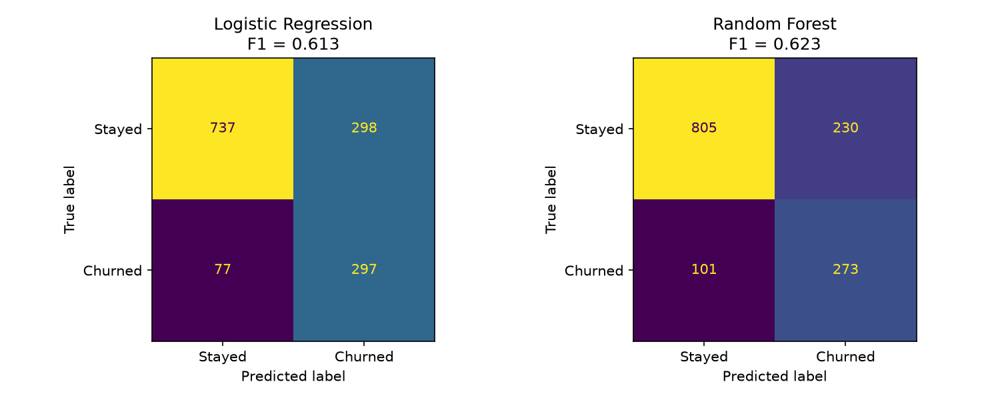
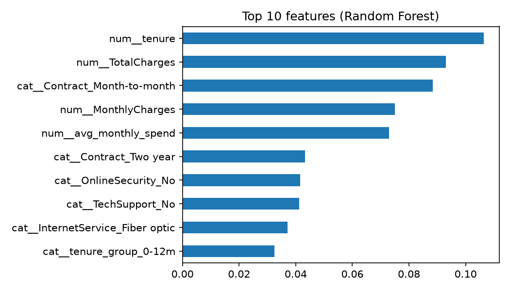

# Customer Churn Prediction

Binary classification project that predicts which telecom customers are likely to churn, using Python, Pandas and scikit-learn. Two models (Logistic Regression and Random Forest) are compared with stratified cross-validation and evaluated on a held-out test set.

## Dataset

[Telco Customer Churn](https://www.kaggle.com/datasets/blastchar/telco-customer-churn) (Kaggle). Each row is a customer with demographics, services, contract and billing details. Target: `Churn` (Yes/No).

- Records: **7,043**
- Churn rate: **26.5%**

## Pipeline

1. **Cleaning:** drop `customerID`; convert `TotalCharges` to numeric and impute its blank values with the median.
2. **Feature engineering:** `num_services` (count of add-on services), `avg_monthly_spend` (TotalCharges / tenure), `tenure_group` (tenure buckets).
3. **Preprocessing:** StandardScaler for numeric features, one-hot encoding for categorical features, wrapped in a scikit-learn `Pipeline` so nothing leaks from validation folds.
4. **Models:** Logistic Regression and Random Forest, both with `class_weight="balanced"` because churners are the minority class.
5. **Validation:** 80/20 stratified train/test split; 5-fold stratified cross-validation on the training set to compare models.
6. **Metrics:** precision, recall, F1-score and confusion matrix on the held-out test set.

## Results

| Model | CV F1 (5-fold) | Test precision | Test recall | Test F1 |
|---|---|---|---|---|
| Logistic Regression | 0.628 | 0.499 | 0.794 | 0.613 |
| Random Forest | 0.627 | 0.543 | 0.730 | 0.623 |




**Key takeaways:** Both models performed almost the same (F1 ≈ 0.62). Random Forest had higher precision (fewer false alarms), while Logistic Regression had higher recall (it caught 79% of churners vs 73%). Which one is better depends on the cost of a retention campaign: if offers are cheap, favor recall; if they are expensive, favor precision. The most influential features were tenure, total charges and month-to-month contract type, and the engineered avg_monthly_spend feature ranked in the top five.
## Run it

```bash
pip install pandas scikit-learn matplotlib
# download WA_Fn-UseC_-Telco-Customer-Churn.csv from Kaggle into this folder
python churn_prediction.py
```

Outputs: `confusion_matrix.png`, `feature_importance.png`, `results.txt`.

## Possible improvements

- Tune hyperparameters with GridSearchCV
- Try gradient boosting (XGBoost / LightGBM)
- Adjust the decision threshold to trade precision against recall for a retention campaign
